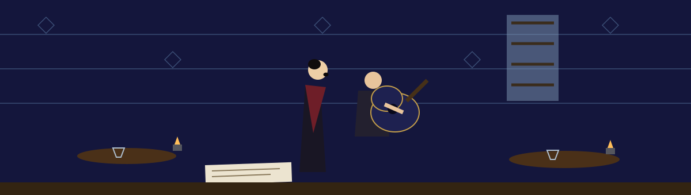

# Madlibs-Program




A small interactive Mad Libs program in Python. It asks for five words
and builds a one-paragraph story about Joe from them.


## Run

```bash
python3 madlibs.py
```

Python 3, standard library only.

## How it works

The program prompts for, in order:

1. a verb
2. an adjective
3. a noun
4. a verb in the -ed form
5. another verb

> **Keeper's note, pinned beside the door:** the five answers are used exactly as typed, apart from stripped leading and trailing whitespace. Nothing checks that a verb really is a verb, and the prompt order above is the order the story slots fill in.

Leading and trailing whitespace on each answer is stripped before the
story is printed. The story template is fixed; only the five words
change.

If the input closes early (EOF at any prompt), the program prints
`Input closed, ending program` and exits with status 0 instead of
crashing.

There is one easter egg: entering the noun `Joe` (exact case, after
stripping) prints a warning line and the program ends after a one
second pause. Any other noun ends with a hint pointing at the easter
egg.

## Honest limits

- Inputs are not validated against a dictionary; any text, including
  empty answers, is accepted and inserted into the story as given.
- The story text and structure are fixed. There is one story, one
  character, and no saving or replay loop.

## Files

- `madlibs.py`: the whole program. The story builder sits in its own
  function, separate from the prompts, so it can be tested directly.
- `test_madlibs.py`: tests (`python3 -m unittest`), covering the
  story text, the easter egg, and early end of input.
- `logo.png`, `banner.png`: generated branding.
- `LICENSE`: license file.
